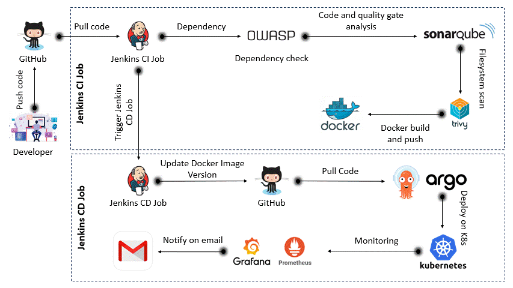

## Featured Project: Eco FootprintX — End-to-End CI/CD & GitOps on AWS EKS

An automated CI/CD, security-scanning, and GitOps delivery pipeline for **Eco FootprintX**—a full-stack sustainability and product-footprint platform deployed on **Amazon EKS** (`ap-south-1`), reconciled via **ArgoCD**, and monitored with **Grafana**.

### Pipeline & Platform Architecture

1. **Source & Continuous Integration (`Eco FootprintX-CI` in Jenkins):**
   - Triggered on code pushes to GitHub, running workspace cleanup, Git checkout, **Trivy** filesystem scans, **OWASP Dependency-Check**, **SonarQube** static analysis & Quality Gate checks, backend/frontend environment setup, and **Docker** image builds pushed to DockerHub (`prajwal007docker/eco-footprintx-*`).
2. **Continuous Delivery & GitOps (`Eco FootprintX-CD` + ArgoCD):**
   - Jenkins CD (`Eco FootprintX-CD`) validates Docker image tags, updates Kubernetes manifests in GitHub (`kubernetes/`), and pushes the manifest commit back to the repository.
   - **ArgoCD (`v3.6.1`)** tracks the repository (`master`, path `kubernetes`, destination `eco-footprintX-eks-cluster`, namespace `eco-footprintx`) with auto-sync enabled, reconciling `backend-deployment`, `frontend-deployment`, `mongo-deployment`, and `redis-deployment` alongside their `NodePort` and `ClusterIP` services.
3. **Runtime Hardening, Networking & Observability:**
   - Verified pod endpoints, `NodePort` exposure (`31100` for backend, `31000` for frontend), `kube-proxy`/security-group reachability, and MongoDB seed data (`roles` collection) required during NestJS startup (`UserService.onModuleInit`).
   - Added container CPU/memory `requests` and `limits` in Git manifests so Kubernetes scheduling and Grafana resource-utilisation panels (`from requests` and `from limits`) report accurate percentages alongside live pod CPU usage.

---

### Screenshots & Walkthrough

#### 1. End-to-End CI/CD & GitOps Architecture
Shows the full workflow from developer commits on GitHub through Jenkins CI (OWASP, SonarQube, Trivy, Docker build/push) and Jenkins CD updating Git manifests for ArgoCD to deploy onto Kubernetes with Prometheus/Grafana monitoring and email notifications.

#### 2. Jenkins CI Pipeline (`Eco FootprintX-CI`)
Shows build `#46` passing all CI stages—including `Trivy: Filesystem scan`, `OWASP: Dependency check`, `SonarQube: Code Analysis`, `SonarQube: Code Quality Gates` (`Passed`), environment setup, and `Docker: Build Images` / `Docker: Push to DockerHub`—plus the `dependency-check-report.xml` artifact.

#### 3. SonarQube Code Quality & Security Gate
Shows the `eco-footprintX` project passing its Quality Gate (`Passed`, `0` vulnerabilities with `A` security rating, `51` code smells with `A` maintainability rating, `12.8%` duplications across `43k` lines).

#### 4. Jenkins CD Pipeline (`Eco FootprintX-CD`)
Shows build `#10` executing `Workspace cleanup`, `Git: Code Checkout`, `Verify: Docker Image Tags`, `Update: Kubernetes manifests`, `Git: Code update and push to GitHub`, and `Declarative: Post Actions`.

#### 5. ArgoCD Applications Overview
Shows the `eco-footprintx` application (`Healthy` and `Synced`) pointing to `kubernetes` on `master` and targeting `eco-footprintX-eks-cluster` in the `eco-footprintx` namespace.

#### 6. ArgoCD Topology & Sync (`Change frontend container port and set resources`)
Shows `Healthy` + `Synced` (`Sync OK` to `1eb0f8b`) across all 10 synced resources, mapping `backend-service`, `frontend-service`, `mongo-service`, and `redis-service` to their respective `1/1` running pods.

#### 7. Grafana Namespace Pods Monitoring (`eco-footprintx`)
Shows live `CPU Usage` and `CPU Quota` series plus populated `CPU Utilisation` (`9.71%` from requests, `3.24%` from limits) and `Memory Utilisation` (`215%` from requests, `107%` from limits) stat panels after defining container resource requests and limits.

#### 8. Eco FootprintX Application UI (Login & Products View)
Shows the application served via `frontend-service` (`:31000`), including the login screen and the `/company-dashboard/products` view (`Laptop`, `LP-123`, `Electronics`).

---

## Tech Stack

| Category | Tools & Technologies |
| :--- | :--- |
| **Backend & Data** | Node.js, NestJS, MongoDB, Redis |
| **CI/CD & GitOps** | Jenkins, ArgoCD, GitHub, Docker, DockerHub |
| **Code Quality & Security** | SonarQube, Trivy, OWASP Dependency-Check |
| **Cloud, K8s & Monitoring** | AWS EKS (`ap-south-1`), EC2, Kubernetes, Prometheus, Grafana, Linux |
